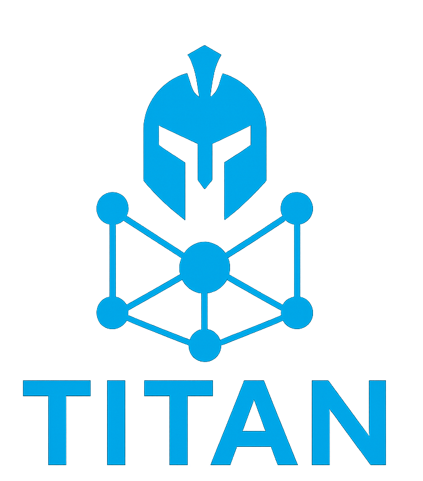

<h1 align="center">TITAN - <i>Threat Intelligence Through Automated Navigation</i></h1>

<p align="center">
  <b>A Typed & Interpretable Framework for Cyber Threat Intelligence Reasoning</b><br>
  <sub>Bridging MITRE ATT&CK, Knowledge Graphs, and Large Language Models</sub>
</p>

<p align="center">
  
</p>

<p align="center">
  <a href="#overview"></a>
  <a href="#pipeline"></a>
  <a href="#datasets"></a>
  <a href="#training"></a>
</p>

---

TITAN is a **typed, bidirectional knowledge graph framework** for **Cyber Threat Intelligence (CTI)** reasoning and **question answering**. It integrates data from the **MITRE ATT&CK STIX** bundles, builds a **TITAN Ontology**, generates **reasoning (CoT)** and **non-reasoning (NoCoT)** datasets, and provides an **end-to-end pipeline** for model training, evaluation, and graph execution.

<h3 align="center">🎬 Demos</h3>

<p align="center">
  <a href="images/demo3.gif">
    
  </a><br>
  <sub>TITAN with Chain of Thought (CoT)</sub>
</p>

<p align="center">
  <a href="images/demo1.gif">
    
  </a><br>
  <sub>No Chain of Thought (Example 1)</sub>
</p>

<p align="center">
  <a href="images/demo2.gif">
    
  </a><br>
  <sub>No Chain of Thought (Example 2)</sub>
</p>

<p align="center">
  <a href="images/demo4.gif">
    
  </a><br>
  <sub>TITAN as a tool for a Cybersecurity Agent</sub>
</p>


---

## Overview

TITAN implements the full pipeline described in the  paper *TITAN: Graph-Executable Reasoning for Cyber Threat Intelligence*.  
It comprises:

1. **Typed Graph Construction** — builds a **bidirectional knowledge graph** from MITRE ATT&CK STIX data using the TITAN Ontology, where each edge is semantically typed (e.g., `uses_attack_pattern`, `mitigates_attack_pattern`).
2. **Dataset Generation** — creates large-scale QA/navigation datasets in both **CoT** and **NoCoT** formats, with executable relational paths (`<PATH>…</PATH>`).
3. **Data Splitting** — produces train/validation/test splits across CTI sections.
4. **Path-Planner Training** — fine-tunes LLMs for **path generation** using LoRA adapters (Unsloth + TRL).
5. **Graph Execution** — executes generated paths over the TITAN Graph to return grounded entities and interpretable reasoning traces.

---

## Repository Structure
```
TITAN/
├─ datasets/
│  ├─ CoT/
│  ├─ NoCoT/
│  └─ create_dataset_splits.py          # split into train/val/test
├─ utils/
│  ├─ build_graph.py                    # STIX → TITAN Ontology Graph (GraphML)
│  ├─ build_dataset.py                  # Graph + YAML templates → dataset JSON
│  ├─ paraphrase.py                     # optional: generate target variations via LLM
│  └─ useful_cot.yaml                   # question templates with <PATH>...</PATH> and target
├─ graph_algorithm.py                   # deterministic path execution utilities
├─ train.py                             # LoRA SFT training (Unsloth + TRL)
├─ test.py                              # interactive tester for path planning & execution
├─ modify_target.py                     # apply paraphrased targets to YAML/JSON
├─ AGENTS.md                            # guide for coding agents working on the repository
└─ README.md
```

> Note: `paraphrase.py` is optional and not used unless applied via `modify_target.py`.

### AGENTS.md

We added an [`AGENTS.md`](AGENTS.md) file so that coding agents can read and work on the code more reliably. It summarises the role of each script, the pipeline commands with their actual CLI arguments, the `<PATH>` format, the conventions that must stay consistent across files (e.g. the chat template shared by `train.py` and `test.py`), and the checks to run after editing.

---

## Requirements

- Python **3.9+**
- Local MITRE **ATT&CK STIX** JSON bundles (e.g., `../attack-stix-data/`)
- (Optional) GPU for LLM steps (`paraphrase.py`, training)

### Installation
```bash
python -m venv .venv
source .venv/bin/activate           # Windows: .venv\Scripts\activate
pip install -U pip

pip install networkx pandas pyyaml tqdm scikit-learn
# For model training and testing:
pip install torch transformers accelerate datasets trl unsloth
```

---

## 1. Build the TITAN Graph

Script: `utils/build_graph.py`  
Generates `titan_graph.graphml` (bidirectional, typed graph).

```bash
python utils/build_graph.py --base ../attack-stix-data --out titan_graph.graphml --log-file build_log.txt
```

> The resulting graph follows the **TITAN Ontology**, distinguishing semantic directions (e.g., `uses_attack_pattern` ↔ `used_by_intrusion_set`) and ensuring all relations are mirrored with coherent inverse semantics.

---

## 2. Generate CoT / NoCoT Datasets

Script: `utils/build_dataset.py`  
Inputs:
- `titan_graph.graphml`
- `utils/useful_cot.yaml` — templates with `<PATH>...</PATH>` and `target`

Outputs:
- `datasets/CoT/NAVIGATION_DATASET.json`
- `datasets/CoT/NAVIGATION_QUESTION_PER_SECTION.json`

Example:
```bash
python utils/build_dataset.py \
  --templates utils/useful_cot.yaml \
  --graph titan_graph.graphml \
  --out datasets/CoT/NAVIGATION_DATASET.json \
  --out-sections datasets/CoT/NAVIGATION_QUESTION_PER_SECTION.json
```

Re-run for **NoCoT** using the corresponding output folder:
```
datasets/NoCoT/
```

---

### (Optional) Convert JSON → CSV

```bash
python - <<'PY'
import json, pandas as pd, os
inp="datasets/CoT/NAVIGATION_DATASET.json"; out="datasets/CoT/NAVIGATION_DATASET.csv"
data=json.load(open(inp,"r",encoding="utf-8"))
df=pd.DataFrame(data)
if "question" in df.columns: df=df.rename(columns={"question":"Question"})
os.makedirs(os.path.dirname(out), exist_ok=True)
df.to_csv(out, index=False, encoding="utf-8")
print("Saved", out)
PY
```

---

## 3. Enhance Targets with LLM (Optional)

You may refine the **Objective/target** terms using `utils/paraphrase.py`.  
This creates `target_variations.csv`, which can be applied to YAML or JSON via `modify_target.py`.

### Apply to YAML templates
```bash
python modify_target.py --csv target_variations.csv \
  --in utils/useful_cot.yaml --out utils/useful_cot.improved.yaml --pick first
```

### Apply to dataset JSON
```bash
python modify_target.py --csv target_variations.csv \
  --in datasets/CoT/NAVIGATION_DATASET.json \
  --out datasets/CoT/NAVIGATION_DATASET.improved.json \
  --pick longest
```

---

## 4. Create Train/Val/Test Splits

Script: `datasets/create_dataset_splits.py`  
Inputs:
- CSV dataset (`Question` column required)
- Section mapping JSON

Outputs:
```
datasets/CoT/COMPLETE/train_dataset.csv
datasets/CoT/COMPLETE/val_dataset.csv
datasets/CoT/COMPLETE/test_dataset.csv
```

Example:
```bash
python datasets/create_dataset_splits.py \
  --csv datasets/CoT/NAVIGATION_DATASET.csv \
  --json datasets/CoT/NAVIGATION_QUESTION_PER_SECTION.json \
  --out datasets/CoT/COMPLETE \
  --train 0.80 --val 0.05 --test 0.15 --seed 42
```

---

## 5. Train the Path-Planner (LoRA SFT)

Script: `train.py` — fine-tunes an LLM (e.g., Phi-3.5, LLaMA, Qwen) using LoRA adapters.

Dataset directory structure:
```
TITAN_COMPLETE_DATASET/
  ├─ train_dataset.csv
  ├─ val_dataset.csv
  └─ test_dataset.csv
```

Example:
```bash
python train.py \
  --data TITAN_COMPLETE_DATASET \
  --out MODELS/phi_titan \
  --model unsloth/Phi-3.5-mini-instruct \
  --lr 3e-4 --train-bsz 8 --eval-bsz 8 --grad-accum 2 \
  --epochs 8 --seq-len 2048 --seed 42
```

> This script saves LoRA adapters and tokenizer into the `--out` directory.  
> Reduce `--train-bsz` or increase `--grad-accum` if GPU memory is insufficient.

---

## 6. Interactive Testing and Graph Execution

Script: `test.py`  
Loads the trained model, generates an executable `<PATH>...</PATH>` plan, and executes it over the TITAN Graph.

```bash
python test.py \
  --model MODELS/phi_titan \
  --names NAMES.txt \
  --graph titan_graph.graphml \
  --rels Relationship_Descriptions.txt
```

Example query:
```
Which mitigations apply to techniques used by the Carberp malware?
```

The system generates a CoT reasoning trace, an executable path, and the final grounded entities.

---

## Troubleshooting

- **Missing columns** — rename `question` → `Question` before splitting.  
- **Unknown mappings** — may be excluded or labeled as `Unknown`.  
- **Small sections** — the splitter balances small groups automatically.  
- **GPU unavailable** — training runs on CPU but will be slow.  
- **CLI arguments not supported** — set paths directly in scripts.

---

## Quick CoT Pipeline Example
```bash
# 1. Build graph
python utils/build_graph.py --base ../attack-stix-data --out titan_graph.graphml

# 2. Build dataset
python utils/build_dataset.py \
  --templates utils/useful_cot.yaml \
  --graph titan_graph.graphml \
  --out datasets/CoT/NAVIGATION_DATASET.json \
  --out-sections datasets/CoT/NAVIGATION_QUESTION_PER_SECTION.json

# 3. (Optional) Apply paraphrased targets
python modify_target.py --csv target_variations.csv \
  --in datasets/CoT/NAVIGATION_DATASET.json \
  --out datasets/CoT/NAVIGATION_DATASET.improved.json

# 4. Convert to CSV
python - <<'PY'
import json, pandas as pd, os
inp="datasets/CoT/NAVIGATION_DATASET.json"; out="datasets/CoT/NAVIGATION_DATASET.csv"
data=json.load(open(inp,"r",encoding="utf-8")); df=pd.DataFrame(data)
if "question" in df.columns: df=df.rename(columns={"question":"Question"})
os.makedirs(os.path.dirname(out), exist_ok=True); df.to_csv(out, index=False, encoding="utf-8")
print("Saved", out)
PY

# 5. Split
python datasets/create_dataset_splits.py \
  --csv datasets/CoT/NAVIGATION_DATASET.csv \
  --json datasets/CoT/NAVIGATION_QUESTION_PER_SECTION.json \
  --out datasets/CoT/COMPLETE --train 0.80 --val 0.05 --test 0.15

# 6. Train
python train.py --data TITAN_COMPLETE_DATASET --out MODELS/phi_titan

# 7. Test
python test.py --model MODELS/phi_titan --names NAMES.txt --graph titan_graph.graphml --rels Relationship_Descriptions.txt
```


